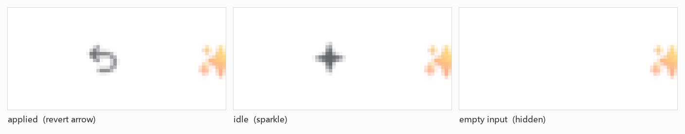

# dsh-prompt-expert

输入框右侧的一个按钮：点一下，把草稿增强成清晰的提示词；结果直接写回输入框，按钮随即变成「恢复原文」。

形态照 WorkBuddy 输入框里的增强按钮做的（它内部叫 `EnhanceButton` / `useEnhancePrompt`，文案 `input.enhance.*`）：一个按钮原地换状态，没有面板、没有对比条、没有额外的提示条。

| 状态 | 长什么样 | 点一下 |
| --- | --- | --- |
| 空闲 | ✨ 增强提示词 | 把草稿增强后写回输入框 |
| 进行中 | ◌ 增强中... | 取消这次请求（草稿不动） |
| 已增强 | ↩ 恢复原文 | 把增强前的草稿放回去 |
| 失败 | ✨ 变红，浮提示错误 | 重试 |

- 输入框为空时按钮直接隐藏，不占位。
- 增强后只要自己改动过文字，「恢复原文」就自动消失，不会覆盖后来写的内容。
- 草稿里有**引用选中内容**（官方 `引用文本` 的引用块，或 `dsh-client-ui-quote` 的引用 chip）时，引用原样保留并放在改写结果上方，只增强其余文字；「恢复原文」连引用一起还原。
- 文件/会话引用 chip 和命令 chip 仍拒绝增强：把这类 chip 移到别处会改变提示词含义。

## 工作方式

- 浏览器半边（`client.js`）：在 `conversation.input.right` 槽位注册那一个按钮。引用的两种形态（官方 `QuoteNode` 与 `dsh-client-ui-quote` 的 reference chip）都从宿主公开状态/自身 DOM 标记读出，增强成功后用 `DraftSnapshot`（`text` + `references`/`quotes`）写回，不会把引用变成纯文本。
- 宿主半边（`index.js`）：注册本机回环路由 `POST /prompt-expert/enhance`，用 profile 默认模型（`agentDefaultModel`）改写**引用以外的文字**；`reasoningEffort: off` 省 token，模型不认这个字段时自动去掉重试一次。
- 请求带 `sessionId`，用量记在发起会话上（费用插件能看到）。

## 已实测

- 真实点击：草稿「帮我把这个插件的 readme 改成中文，别太长，保留原来的表格」
  → 「把这个插件的 README 翻译成中文，篇幅不要过长，保留原有的表格结构。」（deepseek-flash，0.8s）
- 点「恢复原文」→ 原文一字不差回来。
- 清空输入框 → 按钮消失。
- 路由护栏：空文本 422、GET 405、未知路径 404、非本机请求 403。
- 引用兼容（`npm test`，60 组断言）：官方引用块 + 文字、`dsh-client-ui-quote` 引用 chip + 文字、两条引用夹文字，增强后引用仍在、顺序不变，`DraftSnapshot` 的 `text`/`references`/`quotes` 坐标与非重叠校验全部通过。

## 范围

只做「增强并写回」这一件事：没有设置页、没有斜杠命令、没有流式预览、没有快捷键。
